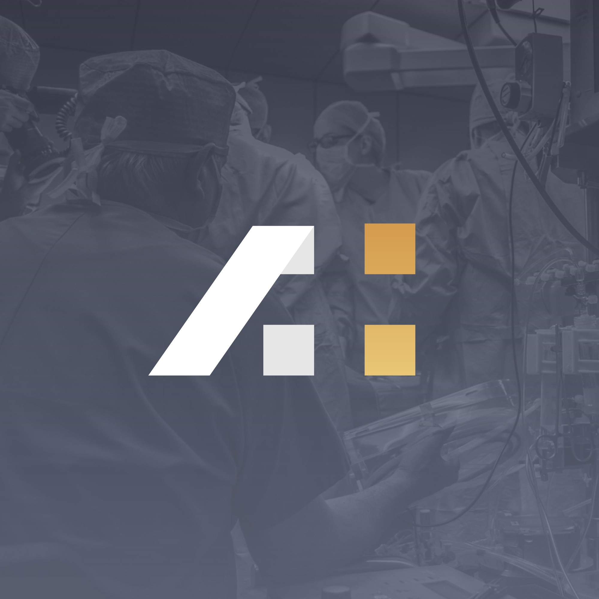

<div align="center">

  

  # 🌌 Mohammad Amaan Bhat — Developer Portfolio v2.0

  **A state-of-the-art, high-performance developer portfolio built with React 19, Vite, and a custom Midnight Nebula design system.**

  <p align="center">
    <a href="https://amaandev.me"><strong>🌐 Live Portfolio: amaandev.me</strong></a> •
    <a href="https://github.com/Friedayy"><strong>GitHub</strong></a> •
    <a href="https://www.linkedin.com/in/frieday/"><strong>LinkedIn</strong></a> •
    <a href="mailto:amaandev253@gmail.com"><strong>Email</strong></a>
  </p>

  <p align="center">
    
    
    
    
    
  </p>

</div>

---

## 📖 Overview

Welcome to the personal developer portfolio repository of **Mohammad Amaan Bhat**. Completely re-architected in **v2.0** from vanilla scripts to a modern **React 19 + Vite** single-page application. 

The site features the custom **Midnight Nebula / Linear Luxe** aesthetic — deep obsidian surfaces, real-time 60fps organic aurora drifts, high-precision starry micro-dot parallax matrix, frosted glass containers with specular top highlights, and instant client-side routing.

---

## ✨ Key Features & Architecture

* **🌌 Midnight Nebula Design System**:
  * **Interactive Canvas Backdrop**: Smooth mathematical aurora mesh (Electric Indigo, Luminous Cyan, Deep Violet) layered with a starry micro-dot grid and silky lerped parallax scroll.
  * **Dual Palette Engine**: Seamlessly switch between dark **Midnight Nebula** (`#07090e`) and light **Porcelain Luxury** (`#f8fafc`), with theme preferences persisted in `localStorage`.
  * **Linear Luxe Glassmorphism**: Frosted glass cards with specular top edge highlights (`inset 0 1px 0 rgba(255, 255, 255, 0.08)`), micro-glow borders, and titanium text gradients.

* **⚡ Hero Experience**:
  * **Live Status Badge**: Pulsing *"Available for Opportunities"* availability indicator with emerald glow.
  * **Typewriter Roles**: Smooth dynamic rotation through *Full Stack Developer*, *Backend Engineer*, *UI/UX Enthusiast*, and *Gamer*.
  * **Profile DP Modal**: Clickable avatar with instant frosted glass backdrop modal, Instagram handle link, and high-res preview.
  * **Hero Quick Actions**: Direct resume download, contact leap, and verified social badges.

* **📊 Dedicated "Ongoing Progress & Roadmap" Page (`#/ongoing`)**:
  * Real-time sprint dashboard showcasing current active development tickets, GitHub commit telemetry, milestone progress bars, and upcoming feature roadmap.
  * Eye-catching glowing navigation pill button in the header for instant navigation.

* **📂 Featured Projects Showcase**:
  * Interactive project cards with category badges, numeric indices, tech pills, GitHub repository links, and expandable preview drawers.

* **📬 Zero-Latency Contact System**:
  * **Serverless Production Delivery**: Direct client-side dispatch via **Web3Forms** — messages land in `amaandev253@gmail.com` without requiring an active backend server.
  * **Local Express Companion (`server.js`)**: Built-in Node.js/Express server with Nodemailer SMTP integration and persistent logging in `data/messages.json` for local development.

* **🛰️ Telemetry Dock & Sidebar**:
  * Floating desktop dock and mobile sliding drawer with quick section jumps and live status telemetry.

---

## 🛠️ Tech Stack

| Domain | Technologies |
| :--- | :--- |
| **Frontend Core** | **React 19**, JSX, ES Modules |
| **Build & Tooling** | **Vite 6**, React Plugin |
| **Styling & Effects** | Vanilla CSS3 Design Tokens, HTML5 Canvas 2D API |
| **Icons & Assets** | **Lucide React**, Custom SVG brand logos |
| **Backend & Email (Dev)** | **Node.js**, **Express 5**, **Nodemailer**, **CORS**, **Dotenv** |
| **Serverless Email (Prod)**| **Web3Forms API** |
| **Hosting & CI/CD** | **GitHub Pages**, **GitHub Actions**, Custom Domain (`amaandev.me`) |

---

## 📁 Repository Structure

```plaintext
portfolio/
├── .github/
│   └── workflows/
│       └── deploy.yml      # Automated GitHub Actions deployment pipeline
├── data/
│   └── messages.json       # Local inquiry records (git-ignored)
├── public/
│   ├── CNAME               # Custom domain config (amaandev.me)
│   └── images/             # Profile avatars, banners & logo assets
├── src/
│   ├── components/         # Modular React components
│   │   ├── Contact.jsx     # Contact form with Web3Forms & local API
│   │   ├── Experience.jsx  # Experience timeline
│   │   ├── FloatingDock.jsx# Quick floating actions
│   │   ├── Hero.jsx        # Hero section with role typewriter & bio
│   │   ├── InstagramDpModal.jsx # Avatar modal preview
│   │   ├── Navbar.jsx      # Sticky header with theme toggle & Ongoing button
│   │   ├── Projects.jsx    # Project showcase cards
│   │   ├── RightSidebarDock.jsx # Telemetry sidebar
│   │   ├── SiteBackdrop.jsx# 60fps aurora canvas & parallax star-dot grid
│   │   └── Skills.jsx      # Categorized skill chips
│   ├── data/
│   │   └── portfolioData.js# Centralized portfolio content & metadata
│   ├── pages/
│   │   └── OngoingProgressPage.jsx # Active sprint & roadmap dashboard
│   ├── App.css             # Component styling & animations
│   ├── App.jsx             # Main application orchestrator & client router
│   ├── index.css           # Global design system & theme tokens
│   └── main.jsx            # React root entry point
├── server.js               # Express API for contact handling & SMTP
├── vite.config.js          # Vite configuration with embedded dev API plugin
├── package.json            # Scripts & project dependencies
└── README.md               # Project documentation
```

---

## 🚀 Showcased Projects

| Project | Description | Stack / Links |
| :--- | :--- | :--- |
| **[Ledger](https://github.com/Friedayy/Expense-tracker-ledger)** | Real-time expense tracker ledger to monitor income, expenses, and net balance with analytics. | [Repository](https://github.com/Friedayy/Expense-tracker-ledger) |
| **[ShopHub](https://github.com/Friedayy/ecommerce-platform)** | Modern full-stack e-commerce web app with product listings, cart management, and checkout flows. | [Repository](https://github.com/Friedayy/ecommerce-platform) |
| **[React Apps](https://github.com/Friedayy/react-projects)** | Interactive frontend applications, experiments, and custom component implementations. | [Repository](https://github.com/Friedayy/react-projects) |

---

## 💻 Running Locally

### 1. Clone the repository
```bash
git clone https://github.com/Friedayy/Portfolio.git
cd Portfolio
```

### 2. Install dependencies
```bash
npm install
```

### 3. Start development server
```bash
# Start Vite frontend (http://localhost:5173)
npm run dev

# Or start both frontend and local Express backend concurrently
npm run dev:all
```

### 4. Build for production
```bash
npm run build
npm run preview
```

---

## 🚢 Deployment & CI/CD

The portfolio is deployed directly to **[amaandev.me](https://amaandev.me)** via **GitHub Actions**:

1. Any push to `main` triggers `.github/workflows/deploy.yml`.
2. The workflow performs a clean install (`npm ci`), builds the production bundle with Vite (`npm run build`), configures 404 fallbacks for client routing, and publishes to GitHub Pages.
3. Custom domain mapping is maintained automatically through `public/CNAME`.

---

## 📬 Connect with Me

* **Website**: [amaandev.me](https://amaandev.me)
* **GitHub**: [@Friedayy](https://github.com/Friedayy)
* **LinkedIn**: [Mohammad Amaan Bhat](https://www.linkedin.com/in/frieday/)
* **Twitter / X**: [@bhatAmaan_](https://x.com/bhatAmaan_)
* **Instagram**: [@_bhatamaan_](https://www.instagram.com/_bhatamaan_/)
* **Email**: [amaandev253@gmail.com](mailto:amaandev253@gmail.com)

---

<div align="center">
  <sub>Designed &amp; Developed with ⚡ by <a href="https://github.com/Friedayy">Mohammad Amaan Bhat</a></sub>
</div>
